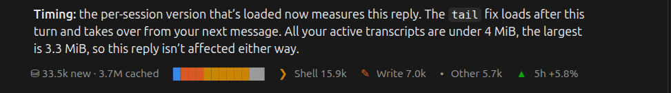
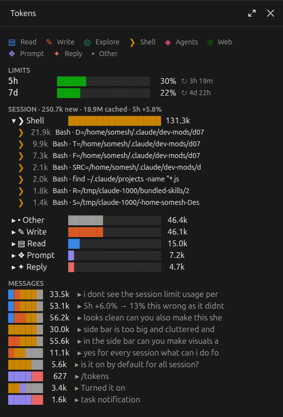

# token-meter

A Claude Code mod that shows where your tokens go. It adds a one-line summary under each reply and a `/tokens` side panel that breaks usage down by action (reading files, exploring, writing code, shell, subagents and so on), down to individual tool calls.





## What it shows

**Under each reply**, one line for that message:

- tokens used: new tokens (input, cache writes, output) and cache reads
- a small coloured bar splitting the message across actions
- the top three actions with their tokens
- `▲ 5h +x%`: how much of your 5-hour limit this session used for the message

**The `/tokens` side panel:**

- **Legend**: each action's icon and colour
- **Limits**: your account's 5-hour and 7-day usage, with reset times
- **Session**: tokens per action. Click a row to see the calls behind it (each command, file or search with its tokens)
- **Messages**: your last 10 messages. Click one to see every call it made

Actions: ▤ Read · ✎ Write · ◎ Explore · ❯ Shell · ◈ Agents · ⊕ Web · ❖ Prompt · ✦ Reply · • Other

## Install

At the prompt of a Claude Code terminal session:

```
/plugin install token-meter --marketplace SomeshRao007/claude-token-meter
```

Answer `y` to add the marketplace, then pick a scope. The user scope loads it in every session.

From a shell:

```bash
claude plugin install token-meter --marketplace SomeshRao007/claude-token-meter
```

In the Claude desktop app, where `/plugin` doesn't run: click **+** next to the prompt box, then **Plugins**, **Add marketplace** with `SomeshRao007/claude-token-meter`, then **Add plugin**. A mod installed from a terminal at the user scope also loads in the desktop app's Code tab.

## Open the side panel

```
/tokens
```

The line under replies needs no command: it appears from the next reply after the mod loads.

## Run it from a clone

```bash
git clone https://github.com/SomeshRao007/claude-token-meter.git ~/.claude/mods/token-meter
```

```bash
claude --plugin-dir ~/.claude/mods/token-meter
```

To load it in every session without installing it, including the desktop app, add this to `~/.claude/settings.json`:

```json
"env": { "CLAUDE_CODE_PLUGIN_DIRS": "~/.claude/mods/token-meter" }
```

Use either this or the install, not both, or the mod loads twice.

Checks, from the mod's folder:

```bash
claude plugin validate .
```

```bash
claude plugin test .
```

## How the numbers are worked out

- **New vs cached.** "New" is uncached input, cache writes and output. "Cached" is the conversation being re-read from the prompt cache on every request, which counts far less toward your limits.
- **Per action.** What the model writes to make a tool call is charged to that call. Its result is charged to it too, because the result is what the next request sends back to the model. The first request of a message is charged to "Prompt" (your message plus the conversation so far). A text-only response is charged to "Reply".
- **5h per session.** Claude only reports the 5-hour limit for your whole account. For each message, the mod reads your other local sessions' transcripts (`~/.claude/projects`) to see what they used over the same time, then shows this session's share of the account's change. Tokens are weighted roughly by price (output ×5, cache reads ×0.1). If that scan fails, the line shows `5h ≤ +x%`, the account's change, which this session's share can't exceed.

## Limitations

- Usage from another computer or from Claude on the web isn't in local transcripts, so it counts toward the session's share.
- Every model is weighted at the same price.
- The account percentage moves in coarse steps, so a short message can show `+0.0%` or a bigger jump.
- The 5h and 7d figures appear only on plans with usage limits.
- The line is matched to a reply by its closing text. If two messages end with identical text, both show the newer line.
- Reading only the end of large transcripts uses `tail`, so it works on macOS and Linux.

Built and tested on Claude Code 2.1.309. The mod API is early access and may change between releases.
